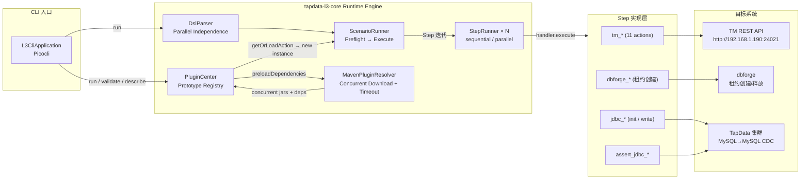
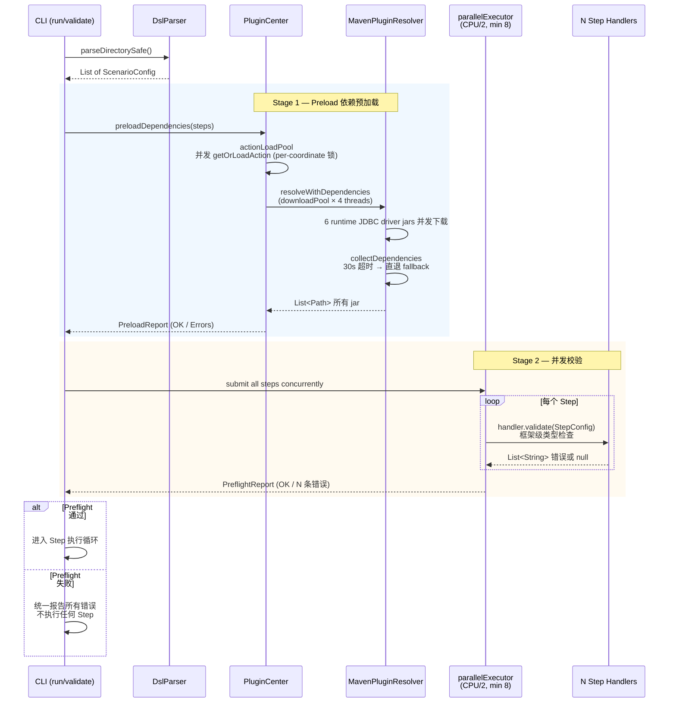
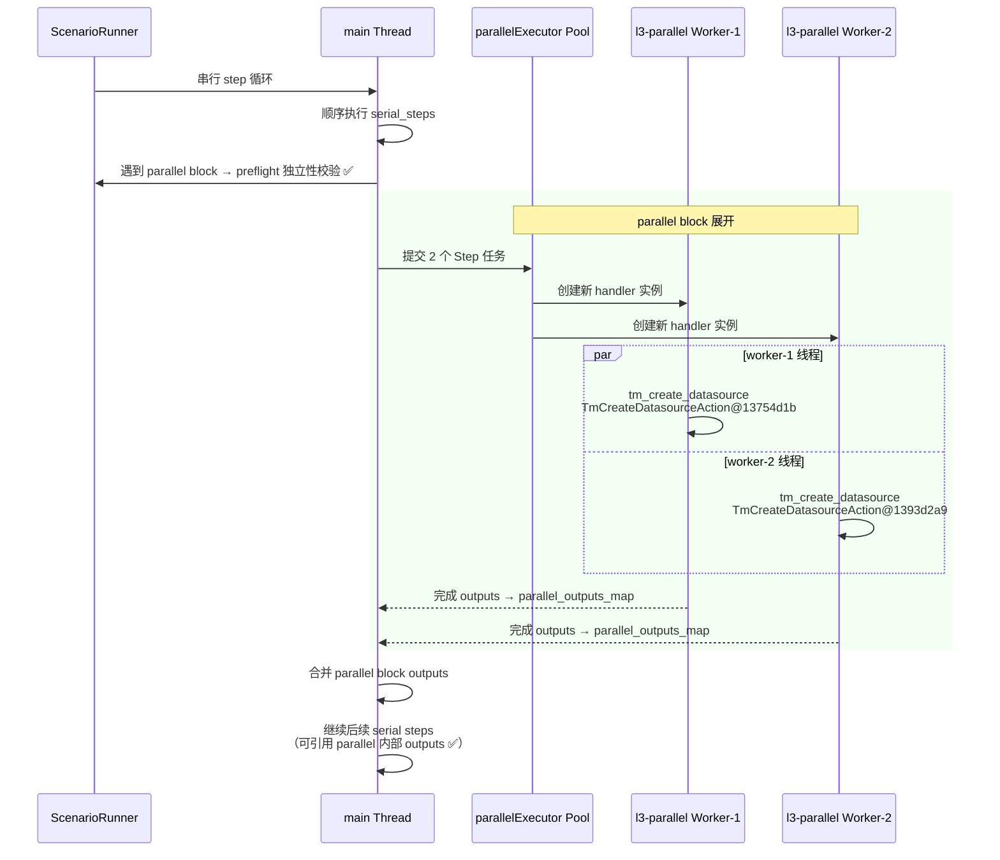
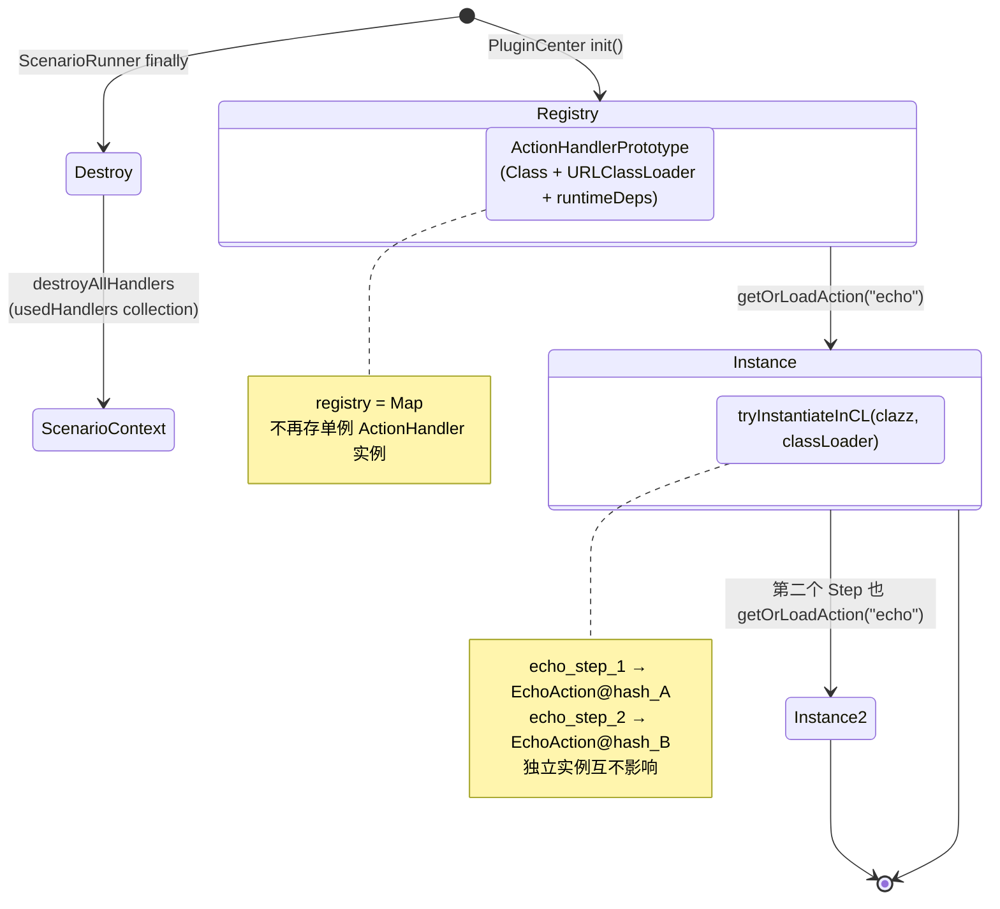
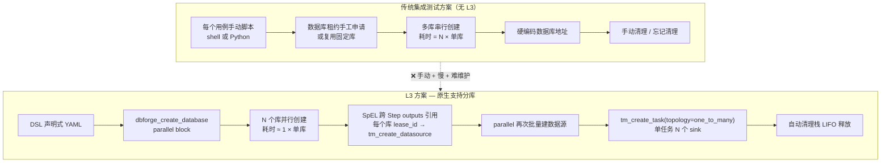

# TapData L3 集成测试框架详细设计文档 (System Detailed Design)

> **版本**：v2.3（异步超时 + SpEL 空安全 + parallel 独立性校验）
> **更新日期**：2026-11-02
> **变更说明**：v2.2 基础上新增三项改进——(1) 断言/等待 Step 走 `BaseStep` 基类的 `CompletableFuture` + `orTimeout` 异步执行，`timeout_seconds` 在 DSL 解析期和运行期双重强制校验，超时抛出 `StepTimeoutException`；(2) `SafeSpelEvaluator` 求值前先正则抽取 `#steps['X'].outputs['Y']` 引用并逐一校验，缺失时抛出携带诊断信息的 `SpelNullReferenceException`；(3) `parallel:` 块引入独立性硬规则——内部 Step 严禁 cross-step output 引用，DSL Parser 自动校验并拒绝。

## 1. 概述 (Overview)

### 1.1 背景与目标

TapData 作为一款异构数据实时同步与 CDC（变更数据捕获）中间件，其集成测试涵盖了底层数据库配给、数据源创建、同步任务编排、CDC 数据变更注入以及多端一致性校验。
本框架旨在提供一套 **L3 级（全链路/端到端）集成测试自动化解决方案**：

1. **DSL 驱动**：使用声明式 YAML 编排测试用例，将复杂的测试场景抽象为标准的 `Step`。
2. **数据库即代码 (Database-as-Code)**：以 Step 形式包装 dbforge，实现多数据库多租户的秒级创建与自动回收。
3. **环境与组隔离**：支持功能测试组（共享环境）与破坏性测试组（独立隔离环境）的混合调度。
4. **插件化扩展**：基于 **PF4J 核心**（`DefaultPluginManager` + `PluginClassLoader`）实现插件生命周期管理与类加载隔离；**PluginCenter（插件中心）** 作为 tapdata-l3-core 的唯一对外门面，所有需要插件 Step 的地方都通过 PluginCenter 获取实例——PF4J 退居内部实现细节；Spring Boot 只做依赖注入和配置管理，不依赖 Spring 自动装配组件。
5. **极佳的 CI/CD & 本地体验**：以单个 Executable Fat Jar 形式发布，支持在本地命令行及 GitHub Actions 中运行，并提供智能失败诊断面板与分级日志。
6. **全方位指标度量与双格式报告**：通过 Step 采集 CDC 延迟、吞吐量、节点资源消耗及 dbForge 配给耗时，同步生成机器可读的结构化报告（JSON/JUnit XML）与交互式可视化 HTML 报告。

### 1.2 与已有测试资产的关系

L3 框架与 L1/L2 共存于同一 `tapdata-it/` 仓库，**包名统一为 `io.tapdata.it.*`**：

| 层 | 包名前缀 | 运行方式 | 技术栈 |
|---|---|---|---|
| **L1** | `io.tapdata.it.*` | JUnit5 + Failsafe，模块内 `src/it/java` | Spring Boot Test（EngineIT）/ 纯 JUnit（ConnectorIT） |
| **L2** | `io.tapdata.it.*` | 同 L1 | Spring Boot Test（`@SpringBootTest`）+ Mockito |
| **L3** | `io.tapdata.it.l3.*` | 独立 CLI Fat Jar，DSL YAML 编排 | Picocli + SnakeYAML + Spring Boot 3.x（仅 core runtime） |

**复用策略**（评审 P0/P1 决议）：

| 资产 | 策略 | 理由 |
|---|---|---|
| dbforge 租约供应 | **包装为 Step（不复用 `DbForgeLeaseProvider`）** | L1 的 `DbForgeLeaseProvider` 是 JUnit5 测试生命周期内的阻塞调用；L3 需要异步并行、带超时、带自动清理回调的 Step 语义，重新实现更轻量 |
| ConnectorVerifier 旁路验证 | **L3 校验 Step 复用** | `io.tapdata.it.verifier.ConnectorVerifier` / `JdbcVerifier` / `MongoVerifier` 的 API 完全适配 L3 的旁路断言需求，且无 Spring 依赖 |
| 随机数据生成 (`RandomDataFactory` 等) | **L3 通用 Step 直接引用** | 纯工具类，零框架依赖 |
| L1 `ScenarioContext` / `ConnectorTestContext` | **不复用** | L3 是 DSL 驱动的全局变量上下文，与 JUnit 绑定的测试上下文模型不同 |

---

## 2. 模块结构 (Module Structure)

L3 框架作为 `tapdata-it/` 的新子模块 `tapdata-l3/` 存在，内部按职责拆分为 5 个 Maven 模块：

```
tapdata-it/
├── tapdata-it-common/          ← 已有（L1/L2 共用）
├── tapdata-connector-it/       ← 已有（L1）
├── docs/                       ← 已有（设计文档）
└── tapdata-l3/                 ← 新增：L3 集成测试框架
    ├── tapdata-l3-cli/         ← CLI 入口（Picocli 命令解析 + Fat Jar 打包）
    ├── tapdata-l3-core/        ← 核心 Runtime（DSL Parser / Step Runner / Metrics / Report）—— 唯一依赖 Spring Boot 的模块
    ├── tapdata-l3-plugin/     ← 插件 SPI（ActionHandler 接口 + Step 注解）—— 零运行时依赖，外部 Step 库只依赖这个
    ├── tapdata-l3-common/     ← 通用资产（配置实体 / 上下文容器 / 内置表达式求值器 / 常量）—— 零 Spring 依赖
    └── steps/                  ← 内置 Step 实现（每个 Step 一个 Maven module，独立打包）
        ├── tapdata-l3-step-dbforge/
        ├── tapdata-l3-step-tm-api/
        ├── tapdata-l3-step-assert-jdbc/
        ├── tapdata-l3-step-assert-mongo/
        ├── tapdata-l3-step-fault-inject/
        └── ...
```

**Maven 依赖方向**：

```
tapdata-l3-common    ←——  tapdata-l3-plugin  ←——  steps/*
      ↑                        ↑
      │                        │
tapdata-l3-core    ←——  tapdata-l3-cli
      ↑
tapdata-it-common (可选用例：ConnectorVerifier 用于 assert-* Step)
```

**关键设计约束**：
- `tapdata-l3-plugin` 是最小化依赖集，仅含 SPI 接口和注解，外部 Step 库**只依赖它**（不含 Spring Boot）
- `tapdata-l3-core` 是唯一的 Spring Boot 3.x 模块，负责运行时组装和插件加载
- 每个内置 Step 是独立 Maven module，独立 jar，互不依赖（避免传递 Spring 依赖）
- `tapdata-l3-common` 提供 `SafeSpelEvaluator`（见 §4.3）和 `ScenarioContext` 等通用类，零 Spring 依赖

---

## 3. 整体架构设计 (System Architecture)

### 3.1 架构分层

```
+-----------------------------------------------------------------------+
|                    GitHub Actions / Local Developer                   |
+-----------------------------------------------------------------------+
                                   | (Executes Fat Jar)
                                   v
+-----------------------------------------------------------------------+
|                         tapdata-l3-cli                                 |
|   (Picocli Command Engine / Logger / Failure Diagnostic Reporter)     |
+-----------------------------------------------------------------------+
                                   |
                                   v
+-----------------------------------------------------------------------+
|                   tapdata-l3-core · Runtime Engine                    |
|   ┌──────────────────────────────────────────────────────────────┐    |
|   │  DSL Parser (SnakeYAML)  |  Step Runner (sequential/parallel) │    |
|   │  SafeSpelEvaluator       |  CleanupManager (auto resource gc) │    |
|   │  Metrics Collector       |  Report Generator (JSON/XML/HTML)  │    |
|   └──────────────────────────────────────────────────────────────┘    |
|                                   |                                   |
|   ┌──────────────────────────────────────────────────────────────┐    |
|   │  PluginCenter（插件中心 · 对外门面）                               │    |
|   │    ├─ StepRegistry（统一 Step 注册表：内置 + 外置）               │    |
|   │    └─ PF4J 核心（内部实现细节，外部不可见）                      │    |
|   │         ├─ DefaultPluginManager（生命周期：start/stop/reload）   │    |
|   │         ├─ PluginClassLoader（URLClassLoader 基类，每个插件独立） │    |
|   │         │   └─ Parent-First 查 SPI/宿主依赖 → Self-First 查插件内部 │   |
|   │         └─ @Extension 注解扫描（PF4J 核心自带）                  │    |
|   └──────────────────────────────────────────────────────────────┘    |
+-----------------------------------------------------------------------+
        │                           │                                   │
        │ (Step invocation)          │                                   │
        v                           v                                   v
+---------------+  +-------------------------+  +---------------------+
| 内置 Steps    |  | 外部插件 Steps          |  | 目标系统             |
| dbforge_*     |  | (Maven 私服动态下载)     |  | dbforge 控制面       |
| tm_api_*      |  | com.tapdata.step:*       |  | TapData 产品集群     |
| assert_*      |  | ...                      |  | TM REST API          |
| fault_inject  |  |                          |  | 目标数据库           |
+---------------+  +-------------------------+  +---------------------+
```

### 3.2 核心技术选型

| 模块 | 技术选型 | 说明 / 优势 |
| :--- | :--- | :--- |
| **运行时模块** | Java 17+ / JRE | 生态兼容性与企业级稳定扩展 |
| **Core Runtime** | Spring Boot 3.x | 依赖注入 (DI)、事件监听及生命周期管理；**唯一依赖 Spring Boot 的模块** |
| **CLI 命令行引擎** | Picocli | 帮助文档生成、参数解析、ANSI 颜色渲染；不依赖 Spring Boot |
| **DSL 解析** | SnakeYAML | YAML 解析；Step 内的表达式由 `SafeSpelEvaluator` 求值 |
| **表达式求值** | Spring Expression (SimpleEvaluationContext) | **禁用** `T()` / `new` / `invoke` 等危险操作（见 §4.3），提供内置变量 `${timestamp}` / `${uuid}` 等 |
| **dbforge 集成** | dbforge HTTP API（轻量封装） | 不复用 L1 `DbForgeLeaseProvider`，按 L3 Step 语义重新实现：异步并行、带超时、自动清理回调 |
| **TM API 集成** | REST HTTP Client（Spring WebClient / OkHttp） | 封装为 `tm_api_*` Step 系列（鉴权 / 建任务 / 查状态 / 指标查询） |
| **动态插件加载** | **PF4J 核心 + PluginCenter** | PF4J 提供生命周期管理 + 每个插件独立 `PluginClassLoader`（继承 URLClassLoader，天然隔离依赖版本）；**PluginCenter 作为对外门面**，屏蔽 PF4J 细节，所有 Step 注册和查找都经它；Spring Boot 只做 DI 和配置；插件侧 Spring 依赖一律 `provided` |
| **异步断言与轮询** | Awaitility | CDC 最终一致性校验的优雅轮询与超时断言 |
| **旁路验证** | `tapdata-it-common` 中的 `ConnectorVerifier` / `JdbcVerifier` / `MongoVerifier` | L3 的 assert-* Step 直接复用；直连对端数据库，不走被测产品 |
| **指标采样与报告** | Micrometer + Thymeleaf + Chart.js | 异步采样 Step 执行耗时与 CDC 指标，生成 JSON / JUnit XML / HTML |
| **日志框架** | SLF4J + Logback | ANSI 控制台高亮、`--debug` 模式切换、日志追加写入文件 |

---

## 4. 核心领域模型与 DSL 设计 (Domain Model & DSL)

### 4.1 Step SPI (ActionHandler 接口)

Step 是框架中最小的执行单元——每个 Step 负责一件具体的事（建库、建任务、断言数据、注入故障…）。所有 Step（内置和外部插件）都实现同一个接口：

```java
// tapdata-l3-plugin —— 外部插件只需要依赖这个模块
package io.tapdata.it.l3.plugin;

import io.tapdata.it.l3.common.ScenarioContext;

/**
 * 可复用的测试动作接口。
 * <p>
 * 外部 Step 库只需实现本接口（零 Spring Boot 依赖），
 * 编译为独立 jar 后可被 L3 CLI 动态加载。
 */
public interface ActionHandler {

    /**
     * Action 唯一样称，DSL 中通过 {@code action: "xxx"} 引用。
     */
    String getActionName();

    /**
     * 执行 Step 核心逻辑。
     *
     * @param config  Step 配置（inputs / outputs / hooks / timeout 等）
     * @param context 跨 Step 共享的全局上下文（变量传递、Step 输出引用）
     * @throws Exception Step 执行失败时抛出（将触发失败诊断面板）
     */
    void execute(StepConfig config, ScenarioContext context) throws Exception;
}
```

### 4.2 通用上下文容器 (ScenarioContext)

```java
// tapdata-l3-common —— 零 Spring 依赖
package io.tapdata.it.l3.common;

import java.util.Map;
import java.util.concurrent.ConcurrentHashMap;

/**
 * Scenario 全局变量上下文：承载用户声明的 variables 与各 Step 的 outputs。
 * <p>
 * 本容器与 JUnit 测试生命周期解耦，适配 DSL 驱动的编排模式。
 * 提供 setVariable / setStepOutput 写入和 evaluateExpression 求值能力，
 * 求值器底层委托 {@link SafeSpelEvaluator}。
 */
public class ScenarioContext {

    private final Map<String, Object> variables = new ConcurrentHashMap<>();
    private final Map<String, Map<String, Object>> steps = new ConcurrentHashMap<>();
    private final SafeSpelEvaluator evaluator;

    public ScenarioContext() {
        // 预置内置变量
        variables.put("timestamp", System.currentTimeMillis());
        variables.put("uuid", java.util.UUID.randomUUID().toString());
        this.evaluator = new SafeSpelEvaluator(variables, steps);
    }

    public void setVariable(String name, Object value) {
        variables.put(name, value);
    }

    public void setStepOutput(String stepId, String outputKey, Object value) {
        steps.computeIfAbsent(stepId, k -> new ConcurrentHashMap<>()).put(outputKey, value);
    }

    /**
     * 对可能包含表达式的字符串进行求值。
     * 安全求值器会拒绝 T() / new / invoke 等危险语法。
     */
    public Object evaluateExpression(String expression) {
        if (expression != null && expression.contains("#{")) {
            return evaluator.evaluate(expression);
        }
        return expression;
    }

    public Map<String, Object> getVariables() { return variables; }
    public Map<String, Map<String, Object>> getSteps() { return steps; }
}
```

### 4.3 安全表达式求值器 (SafeSpelEvaluator)

> **评审决议 P1-2 + 空安全**：禁用 `T()` / `new` / `invoke` 等危险操作，使用 `SimpleEvaluationContext`；求值前加入**友好空安全拦截**——引用的 Step 节点不存在或 outputs Key 缺失时，抛出带"Step 名 + 缺失 Key + 可用 outputs 清单"的明确错误，不直接抛出 NPE 或 SpelEvaluationException。

```java
// tapdata-l3-common
package io.tapdata.it.l3.common;

import org.springframework.expression.Expression;
import org.springframework.expression.ExpressionParser;
import org.springframework.expression.spel.standard.SpelExpressionParser;
import org.springframework.expression.spel.support.SimpleEvaluationContext;

import java.util.*;

/**
 * 安全版 SpEL 求值器——仅开放属性访问 + Map 查找能力。
 * <p>
 * 以下语法将被拒绝并抛出 {@link SecurityException}：
 * <ul>
 *   <li>{@code T(java.lang.System).currentTimeMillis()} — 任意静态方法调用</li>
 *   <li>{@code new java.io.File('/etc/passwd')} — 对象实例化</li>
 *   <li>{@code runtime.exec('rm -rf /')} — 任意方法调用</li>
 * </ul>
 * <p>
 * 用户如需时间戳、UUID 等运行时值，使用内置变量：
 * <pre>
 * #{ #variables['timestamp'] }         // 毫秒时间戳
 * #{ #variables['uuid'] }             // UUID v4 字符串
 * #{ #steps['xxx'].outputs['yyy'] }   // 引用其他 Step 的输出（空安全拦截）
 * </pre>
 *
 * ==== 空安全拦截 ====
 * 求值前先用正则提取表达式中所有 #{ ... } 块内的 {@code #steps['STEP_ID'].outputs['KEY']} 引用，
 * 逐一校验：Step 是否存在、Step 是否有 outputs、Key 是否在 outputs 中存在。
 * 任一缺失就抛出 {@link SpelEvaluationException} 子类的 {@link SpelNullReferenceException}，
 * 错误信息形如：
 * <pre>
 * Expression evaluation failed: Step 'create_src_db' did not produce output 'src_db_uri'.
 * Available outputs for this step: [src_db_id, src_db_uri_typo, ...]
 * Total registered steps: [create_src_db, create_sink_db, ...]
 * </pre>
 * 而不是直接抛出 NPE 或 SpEL 内部的 CannotGetPropertyValueException。
 */
public class SafeSpelEvaluator {

    private static final ExpressionParser PARSER = new SpelExpressionParser();

    /** 匹配 #{ ... #steps['STEP_ID'].outputs['KEY'] ... } 片段的正则 */
    private static final java.util.regex.Pattern STEP_REF_PATTERN =
            java.util.regex.Pattern.compile(
                    "#steps\\['([^']+)'\\]\\.outputs\\['([^']+)'\\]");

    private final SimpleEvaluationContext context;
    private final Map<String, Object> variables;
    private final Map<String, Map<String, Object>> stepOutputs;

    public SafeSpelEvaluator(Map<String, Object> variables,
                              Map<String, Map<String, Object>> stepOutputs) {
        this.variables = variables;
        this.stepOutputs = stepOutputs;

        // SimpleEvaluationContext 默认已排除 T()、new、invoke、getType 等危险操作
        this.context = SimpleEvaluationContext.forReadOnlyDataBinding().build();
        context.setVariable("variables", variables);
        context.setVariable("steps", stepOutputs);
    }

    /**
     * 求值入口——先做空安全校验，再交给 SpEL 解析。
     * <p>
     * 校验失败时抛出 {@link SpelNullReferenceException}，携带友好错误信息。
     * 校验通过后，内部 SpEL 求值如果仍然抛异常（例如变量引用不存在），
     * 也会被包装为 {@link SpelEvaluationException} 的子类，而不向上层暴露原始 NPE。
     */
    public Object evaluate(String expression) {
        // 1. 空安全前置校验（Step outputs 引用）
        validateStepReferences(expression);

        // 2. SpEL 求值（SimpleEvaluationContext 已提供安全兜底）
        try {
            Expression exp = PARSER.parseExpression(expression);
            return exp.getValue(context);
        } catch (Exception e) {
            // SpEL 内部异常包装为带上下文的友好异常
            throw new SpelEvaluationException(
                    "Expression evaluation failed for: " + expression, e);
        }
    }

    /**
     * 从表达式中提取所有 #steps['STEP'].outputs['KEY'] 引用，逐一校验。
     */
    private void validateStepReferences(String expression) {
        java.util.regex.Matcher matcher = STEP_REF_PATTERN.matcher(expression);
        while (matcher.find()) {
            String stepId = matcher.group(1);
            String outputKey = matcher.group(2);
            validateStepOutput(expression, stepId, outputKey);
        }
    }

    private void validateStepOutput(String expression, String stepId, String outputKey) {
        // Step 是否存在？
        if (!stepOutputs.containsKey(stepId)) {
            String availableSteps = stepOutputs.keySet().toString();
            throw new SpelNullReferenceException(
                    String.format(
                            "Expression evaluation failed: Step '%s' not found. "
                            + "Total registered steps: %s%n"
                            + "Expression: %s",
                            stepId, availableSteps, expression));
        }

        // Step 是否有 outputs？
        Map<String, Object> outputs = stepOutputs.get(stepId);
        if (outputs == null || outputs.isEmpty()) {
            throw new SpelNullReferenceException(
                    String.format(
                            "Expression evaluation failed: Step '%s' has no outputs yet. "
                            + "It may not have been declared with 'outputs:' or hasn't executed successfully.%n"
                            + "Expression: %s",
                            stepId, expression));
        }

        // Key 是否存在？
        if (!outputs.containsKey(outputKey)) {
            String availableKeys = outputs.keySet().toString();
            throw new SpelNullReferenceException(
                    String.format(
                            "Expression evaluation failed: Step '%s' did not produce output '%s'.%n"
                            + "Available outputs for this step: %s%n"
                            + "Expression: %s",
                            stepId, outputKey, availableKeys, expression));
        }
    }

    /** 空安全异常：Step/Key 缺失时抛出，消息中携带诊断信息 */
    public static class SpelNullReferenceException extends RuntimeException {
        public SpelNullReferenceException(String message) { super(message); }
    }

    /** SpEL 内部求值异常的包装 */
    public static class SpelEvaluationException extends RuntimeException {
        public SpelEvaluationException(String message, Throwable cause) { super(message, cause); }
    }
}
```

### 4.4 DSL 编写示例（含 parallel / foreach 语法）

> **评审决议 P1-5**：DSL 增加 `parallel:` 分组和 `foreach:` 迭代语法。拓扑场景（一对多 / 多对一）由 `create_task` Step 的参数和 `parallel` 语法共同表达。

```yaml
# L3-F-01: MySQL → PostgreSQL CDC 同步黄金路径
case_id: "L3-F-01"
scenario: "MySQL to PostgreSQL CDC Sync"
group: "functional"
description: "测试 MySQL 数据变更通过 TapData 实时同步至 PostgreSQL"

variables:
  table_name: "users_test_#{ #variables['timestamp'] }"

steps:
  # Step 1 & 2 并行：同时创建源端 MySQL 和目标端 PostgreSQL 数据库
  - parallel:
      - id: "create_src_db"
        action: "dbforge_create_database"
        inputs:
          db_type: "mysql"
          keep_alive: false
        outputs:
          - "src_db_uri"

      - id: "create_sink_db"
        action: "dbforge_create_database"
        inputs:
          db_type: "postgresql"
        outputs:
          - "sink_db_uri"

  # Step 3: 初始化源表
  - id: "init_src_table"
    action: "dbforge_execute_sql"
    inputs:
      db_uri: "#{ #steps['create_src_db'].outputs['src_db_uri'] }"
      sql: |
        CREATE TABLE #{ #variables['table_name'] } (id INT PRIMARY KEY, name VARCHAR(50));
        INSERT INTO #{ #variables['table_name'] } VALUES (1, 'Alice');

  # Step 4 & 5: 并行创建两个数据源
  - parallel:
      - id: "create_tap_src_ds"
        action: "tm_api_create_datasource"
        inputs:
          name: "src_ds_#{ #variables['table_name'] }"
          uri: "#{ #steps['create_src_db'].outputs['src_db_uri'] }"
        outputs:
          - "src_ds_id"

      - id: "create_tap_sink_ds"
        action: "tm_api_create_datasource"
        inputs:
          name: "sink_ds_#{ #variables['table_name'] }"
          uri: "#{ #steps['create_sink_db'].outputs['sink_db_uri'] }"
        outputs:
          - "sink_ds_id"

  # Step 6: 创建同步任务（端到端配置，支持一对多/多对一拓扑参数）
  - id: "start_sync_task"
    action: "tm_api_create_sync_task"
    inputs:
      task_name: "task_#{ #variables['table_name'] }"
      source_ds_id: "#{ #steps['create_tap_src_ds'].outputs['src_ds_id'] }"
      sink_ds_ids:
        - "#{ #steps['create_tap_sink_ds'].outputs['sink_ds_id'] }"
      # 拓扑参数：topology=one_to_many 时 sink_ds_ids 接受多个目标
      topology: "one_to_one"   # one_to_one | one_to_many | many_to_one | bidirectional
    outputs:
      - "task_id"

  # Step 7: 轮询等待任务 Running
  - id: "wait_task_running"
    action: "tm_api_wait_task_status"
    inputs:
      task_id: "#{ #steps['start_sync_task'].outputs['task_id'] }"
      expected_status: "running"
      timeout_seconds: 60

  # Step 8: 制造 CDC 增量变更
  - id: "insert_cdc_data"
    action: "dbforge_execute_sql"
    inputs:
      db_uri: "#{ #steps['create_src_db'].outputs['src_db_uri'] }"
      sql: "INSERT INTO #{ #variables['table_name'] } VALUES (2, 'Bob');"

  # Step 9: 旁路异步断言——直连目标 PostgreSQL，不走 TM API
  - id: "assert_data_sync"
    action: "assert_jdbc_data"
    inputs:
      db_uri: "#{ #steps['create_sink_db'].outputs['sink_db_uri'] }"
      sql: "SELECT COUNT(*) FROM #{ #variables['table_name'] }"
      expected: 2
      timeout_seconds: 15


# ============================================================
# foreach 示例：一对多拓扑，3 个目标并行
# ============================================================
steps:
  # ... 建库、建源数据源略 ...

  - foreach:
      var: "sink_idx"
      items: [1, 2, 3]
      steps:
        - id: "create_sink_db_${sink_idx}"
          action: "dbforge_create_database"
          inputs:
            db_type: "postgresql"
            suffix: "${sink_idx}"
          outputs:
            - "sink_uri_${sink_idx}"

  # 聚合 outputs 后一次性建拓扑任务
  - id: "start_topology_task"
    action: "tm_api_create_sync_task"
    inputs:
      topology: "one_to_many"
      sink_ds_ids: "#{ #variables['all_sink_ids'] }"
```

### 4.5 DSL 语法总览

| 元素 | 类型 | 说明 |
|---|---|---|
| `case_id` | string | **必填**，关联 wiki 用例编号（`L3-F-01` / `L3-S-02` 等），门禁和覆盖率追踪用 |
| `scenario` | string | Scenario 名称（出现在报告和 CLI 输出中） |
| `group` | enum | `functional` / `destructive` / `stability`，决定环境隔离级别 |
| `variables` | map | 用户声明的 Scenario 级变量；内置 `timestamp` / `uuid` |
| `steps` | array | Step 序列（顺序执行） |
| `parallel` | block | **并行 Step 组——内部 Steps 必须是高度独立的（无状态、无交叉依赖）**，详见下方规则 |
| `foreach` | block | 迭代器，内部 `steps` 按 `items` 重复执行，迭代变量注入 `${var}` |
| Step | object | 含 `id` / `action` / `inputs` / `outputs` / `hooks` / `timeout_seconds` |
| SpEL 表达式 | `#{ ... }` | 用于引用变量和 Step 输出；**安全求值 + 空安全拦截**，禁止 `T()` / `new` / `invoke` |

#### ⚠️ parallel 块的独立性硬规则

> **规则**：`parallel:` 块内部的所有 Step **必须是高度独立的**——即"无状态、无交叉依赖"。
>
> 如果 Step A 的 `inputs` 引用了 Step B 的 `outputs`（通过 `#{ #steps['B'].outputs['xxx'] }`），**A 和 B 绝不能被编排在同一个 `parallel:` 块中**。必须拆分为顺序步骤（Sequential Steps）流转。

**违反示例**（以下 DSL 会在解析阶段被拒绝）：
```yaml
steps:
  - parallel:
      - id: step_a
        action: dbforge_create_database
        outputs: [uri]
      - id: step_b           # ❌ 错误：B 依赖 A 的 outputs，但在同一 parallel 块
        action: dbforge_execute_sql
        inputs:
          uri: "#{ #steps['step_a'].outputs['uri'] }"
```

**正确写法**：
```yaml
steps:
  - id: step_a               # 顺序：先 A
    action: dbforge_create_database
    outputs: [uri]
  - id: step_b               # 再 B，引用 A 的 outputs
    action: dbforge_execute_sql
    inputs:
      uri: "#{ #steps['step_a'].outputs['uri'] }"
```

#### DSL 解析阶段的 cross-step 依赖校验

DSL Parser 在加载 YAML 时**自动校验**每条 parallel 块内是否存在 cross-step output 引用。实现逻辑：

```java
// tapdata-l3-core —— DSL Parser 并行校验
private void validateParallelIndependence(ParallelBlock block) {
    Set<String> parallelStepIds = block.steps.stream()
            .map(StepConfig::getId).collect(toSet());

    for (StepConfig step : block.steps) {
        // 收集本 Step inputs 中引用的其他 Step outputs
        Set<String> referencedSteps = SpelDependencyExtractor
                .extractStepReferences(step.getInputs());

        // 如果引用在同一 parallel 块内 → 报错
        referencedSteps.retainAll(parallelStepIds);
        if (!referencedSteps.isEmpty()) {
            throw new DslParseException(String.format(
                    "Invalid DSL: Step '%s' inside parallel block references "
                    + "outputs of Step(s) %s which are also inside the same parallel block. "
                    + "Parallel steps must be independent. "
                    + "Use sequential steps instead.",
                    step.getId(), referencedSteps));
        }
    }
}
```

---

## 5. Step 设计（内置 Step 规格）

### 5.0 通用 Step 基类与超时机制

> **评审决议**：所有断言 Step 和异步等待 Step 内部必须是**非阻塞的异步 Future 或高效率轻量轮询**，且**强制要求 `timeout_seconds` 参数**——超时直接抛出 `TimeoutException`，由 ScenarioRunner 捕获并触发失败诊断面板。

所有内置 Step 族继承 `BaseStep`，其 `execute()` 方法的执行流程：

```java
// tapdata-l3-core —— Step 执行框架（简化）
public abstract class BaseStep implements ActionHandler {

    /** Step 实现的同步核心逻辑——由子类 override */
    protected abstract StepResult doExecute(StepConfig config, ScenarioContext ctx) throws Exception;

    @Override
    public final void execute(StepConfig config, ScenarioContext ctx) throws Exception {
        // 1. 强制 timeout_seconds（内置 Step 在 DSL 解析时就会校验）
        int timeoutSeconds = config.getTimeoutSeconds();

        // 2. 异步执行 + 超时控制（CompletableFuture + orTimeout）
        CompletableFuture<StepResult> future = CompletableFuture.supplyAsync(
                () -> {
                    try {
                        return doExecute(config, ctx);
                    } catch (Exception e) {
                        throw new CompletionException(e);
                    }
                }, asyncExecutor);

        try {
            StepResult result = future.orTimeout(
                    timeoutSeconds, TimeUnit.SECONDS).join();
            // 3. 写 outputs 到 ScenarioContext
            if (result.outputs() != null) {
                result.outputs().forEach((k, v) -> ctx.setStepOutput(
                        config.getId(), k, v));
            }
        } catch (CompletionException ce) {
            Throwable cause = ce.getCause();
            if (cause instanceof TimeoutException te) {
                throw new StepTimeoutException(String.format(
                        "Step '%s' timed out after %d seconds",
                        config.getId(), timeoutSeconds), te);
            }
            if (cause instanceof Exception ex) throw ex;
            throw new RuntimeException(cause);
        }
    }
}
```

**强制 `timeout_seconds` 校验发生在两个层面**：

| 层面 | 时机 | 行为 |
|---|---|---|
| **DSL 解析期** | Parser 加载 YAML 时 | 断言 Step / 等待 Step 未声明 `timeout_seconds` 直接拒绝，错误信息：`Invalid DSL: Step 'assert_data_sync' (action=assert_jdbc_data) requires 'timeout_seconds' parameter` |
| **运行期** | StepRunner 执行时 | `BaseStep.execute()` 中 `future.orTimeout(timeoutSeconds, ...)` 硬超时，抛出 `StepTimeoutException` |

**异步等待 Step 的实现模式**（以 `tm_api_wait_task_status` 为例）：

```java
// tm_api_wait_task_status 的 doExecute 内部
protected StepResult doExecute(StepConfig config, ScenarioContext ctx) throws Exception {
    String taskId = (String) config.getInputs().get("task_id");
    String expected = (String) config.getInputs().get("expected_status");

    // Awaitility 异步轮询（轻量，默认每 500ms 一次）
    await()
        .atMost(config.getTimeoutSeconds(), SECONDS)  // 兜底超时（硬超时已在 BaseStep）
        .pollInterval(500, MILLISECONDS)
        .until(() -> tmApiClient.getTaskStatus(taskId),
                actual -> expected.equalsIgnoreCase(actual));

    return StepResult.success();
}
```

### 5.1 dbforge Step 族

L3 需要的 dbforge 能力与 L1 的 `DbForgeLeaseProvider` 不同——L3 要**同时并行多个租约申请**、**带超时/重试**、**自动注册清理回调**。因此按 L3 Step 语义重新实现：

| Action 名称 | 功能 | inputs | outputs | 清理行为 |
|---|---|---|---|---|
| `dbforge_create_database` | 申请一个指定类型的租约 | `db_type`（mysql/pg/mongo…）、`keep_alive`（默认 false）、`ttl_minutes`（默认 60） | `lease_id`、`uri`（完整连接串） | keep_alive=false 时，Scenario 结束自动释放 |
| `dbforge_execute_sql` | 对 dbforge 租约执行 SQL/脚本 | `uri` 或 `lease_id`、`sql`、`driver`（mongo 用 javascript） | 无（或 `affected_rows`） | — |
| `dbforge_destroy_database` | 手动释放租约 | `lease_id` | 无 | — |

### 5.2 TM API Step 族

封装 TapData TM 的 REST API 调用，覆盖 L3 功能场景所需的全部操作。**具体 API 契约从 `tm_api.json`（OpenAPI 3.x 定义）生成**：

| Action 名称 | 对应 TM API | 用途 |
|---|---|---|
| `tm_api_login` | `POST /api/auth/login` | 获取 Token（后续 Step 自动复用） |
| `tm_api_create_datasource` | `POST /api/datasource` | 新增数据源（关联 dbforge 租约 URI） |
| `tm_api_get_datasource` | `GET /api/datasource/{id}` | 查询数据源详情 |
| `tm_api_test_datasource` | `POST /api/datasource/{id}/test` | 连接测试 |
| `tm_api_delete_datasource` | `DELETE /api/datasource/{id}` | 删除数据源 |
| `tm_api_create_sync_task` | `POST /api/Task` | 创建同步任务（支持 topology 参数） |
| `tm_api_start_task` | `POST /api/Task/{id}/start` | 启动任务 |
| `tm_api_stop_task` | `POST /api/Task/{id}/stop` | 停止任务 |
| `tm_api_get_task_status` | `GET /api/Task/{id}` | 查询任务状态 |
| `tm_api_wait_task_status` | 内部轮询 `GET /api/Task/{id}` 直到匹配期望状态 | 等待任务达到目标状态（带 timeout） |
| `tm_api_get_task_metrics` | `GET /api/Task/{id}/metrics` | 获取 CDC 延迟/吞吐量等指标 |
| `tm_api_restart` | 运维 API | HA 场景中重启 TM 实例 |
| `tm_api_kill_engine` | 运维 API | HA 场景中杀引擎节点 |

### 5.3 旁路断言 Step 族（复用 ConnectorVerifier）

> **评审决议**：直接复用 `tapdata-it-common` 的 `ConnectorVerifier` / `JdbcVerifier` / `MongoVerifier`。

| Action 名称 | 复用的 Verifier | 断言方式 |
|---|---|---|
| `assert_jdbc_data` | `JdbcVerifier` | 直连目标库，执行 SQL，比对 expected（支持 Awaitility 轮询） |
| `assert_jdbc_row_count` | `JdbcVerifier.count()` | 直连统计表行数 |
| `assert_jdbc_data_consistency` | `JdbcVerifier.selectByPk()` | 按主键批量取行，与源端比对（验证完整性） |
| `assert_mongo_data` | `MongoVerifier` | 直连查文档 / count / selectByPk |

### 5.4 基础设施 Step 族（L3-S 稳定性测试）

| Action 名称 | 功能 | 场景 |
|---|---|---|
| `system_restart_tapdata_component` | 重启指定组件（TM / 引擎 / 数据库） | L3-S-01 TM 重启恢复 |
| `system_kill_engine_node` | 杀指定引擎进程 | L3-S-02 HA 主备切换 |
| `fault_inject_network_partition` | 网络分区模拟 | HA / 脑裂场景 |
| `fault_inject_db_reject` | 临时让数据库拒绝写入 | 故障注入 |
| `fault_inject_latency` | 注入网络延迟 | 稳定性 / 性能 |
| `system_wait_recovery` | 等待系统恢复（轮询 + 超时） | HA 场景通用 |

---

## 6. 生命周期管理与自动资源回收 (Lifecycle & Auto-Cleanup)

### 6.1 资源回收栈与 Opt-out 机制

```
[ Step Executed Successfully ]
               │
               ▼
[ Step checks input: "keep_alive" ]
        ├── keep_alive == true  ──► [ Skip Registering Cleanup ]
        └── keep_alive == false ──► [ Register Runnable to CleanupManager ]
                                               │
                                               ▼
                                 [ Scenario Teardown Phase ]
                                 (Executes Stack in REVERSE order)
```

1. **自动注册**：`dbforge_create_database` 成功后自动向 `CleanupManager` 注册释放动作（HTTP DELETE `/v1/lease/{id}`）
2. **Opt-out**：设 `keep_alive: true` 跳过注册，保留环境供调试
3. **异常安全**：Scenario 即使在 Step 执行中抛异常，teardown 阶段仍会触发清理（finally 保证）
4. **dbforge 兜底**：即使框架崩溃未清理，dbforge 服务端 TTL（默认 60 分钟）到期后自动回收

### 6.2 TM 资源清理

TM 中的数据源、任务等资源也纳入清理栈：
- `tm_api_create_datasource` → 注册 `tm_api_delete_datasource`
- `tm_api_create_sync_task` → 注册 `tm_api_stop_task` + `tm_api_delete_task`
- 清理顺序：先停任务 → 再删数据源 → 最后释放数据库租约

---

## 7. 动态 Step 扩展机制 (PluginCenter + PF4J)

### 7.1 设计原则

> **核心原则**：**PluginCenter（插件中心）是 tapdata-l3-core 对外暴露的唯一门面**，所有需要获取 Step 实例的地方（StepRunner、ScenarioRunner、CLI 命令等）都走 PluginCenter。PF4J 退居 PluginCenter 内部的实现细节——外部模块的代码中不应出现任何 `org.pf4j.*` 的 import。

这样做的目的有两个：
1. **降低耦合**：将来如果 PF4J 换 OSGi、自研 ClassLoader、或彻底取消插件化，只需改 PluginCenter 内部实现，外部零改动
2. **统一治理**：StepRegistry 的注册/查找/生命周期全收口在 PluginCenter，内置 Step 和外置插件 Step 对消费方无差别

Spring Boot 在这里只做一件事——**依赖注入和配置管理**：PluginCenter、StepRegistry、PF4J 组件都用 `@Component` 注入，插件目录路径、Maven 私服地址等用 `application.properties` 配置。不依赖 Spring Boot 自动装配、不依赖 Spring 插件机制、不依赖任何 Spring 默认组件来发现或加载插件。

### 7.2 选型理由

| 候选 | 优势 | 劣势 |
|---|---|---|
| **PF4J 核心 ✅** | 成熟社区（3k+ stars）；`PluginClassLoader` 原生继承 `URLClassLoader`；API 极简（`loadPlugin` / `startPlugin` / `getExtensions`）；插件目录热加载；与 Maven 构建链天然兼容 | — |
| pf4j-spring | 提供 `SpringPlugin` / `SpringExtensionFinder` | **不需要**——L3 插件不继承 Spring 组件，pf4j-spring 的 Spring 上下文桥接是多余依赖 |
| OSGi | 最强隔离 | 过重，L3 不需要完整模块系统；Spring Boot + OSGi 集成成本高 |
| 自研 URLClassLoader | 完全可控 | 重复造 PF4J 已有的轮子（生命周期管理、依赖解析、错误处理） |

> **经验参考**（从已有类似项目沉淀）：
> - 插件侧 Spring 依赖必须标记 `<scope>provided</scope>`，避免 PF4J 的 `PluginClassLoader` 与宿主 `LaunchedURLClassLoader` 加载**双份 Spring 类**导致 `loader constraint violation`
> - PF4J 版本选择：pf4j-core 3.11+（`DefaultPluginManager` + `@Extension` + `PluginClassLoader` 是稳定 API）
> - pf4j-spring **不引入**——它的 SpringPlugin 继承和 SpringExtensionFinder 桥接在 L3 场景下没有价值

### 7.3 分层架构

```
                    ┌───────────────────────┐
                    │  StepRunner / CLI     │  消费方（运行时执行 Step）
                    │  ScenarioRunner       │
                    └──────────┬────────────┘
                               │  只通过 PluginCenter 获取 Step
                               │  不直接 import PF4J
                               ▼
              ┌───────────────────────────────────────┐
              │            PluginCenter               │  ← 唯一对外门面
              │  ├─ getAction(String actionName)      │  运行时按名称取 Step
              │  ├─ getAllActions()                   │  列出所有已注册 Step
              │  ├─ loadPlugin(mavenCoordinate)        │  动态安装 + 加载
              │  ├─ reloadPlugin(pluginId)            │  热重载
              │  └─ shutdown()                         │  停止 + 清理
              └──────────────┬────────────────────────┘
                             │  内部实现细节
              ┌──────────────┴────────────────────────┐
              │                                         │
              ▼                                         ▼
     ┌───────────────────┐                   ┌────────────────────┐
     │  StepRegistry      │                   │  PF4J DefaultPlugin │
     │  (统一注册表)      │                   │  Manager            │
     │  ConcurrentHashMap │                   │  (生命周期管理)      │
     └───────────────────┘                   └────────┬───────────┘
              ▲                                       │
              │                                       ▼
     ┌────────┴────────┐                  ┌───────────────────────┐
     │ 内置 Step        │                  │ PluginClassLoader     │
     │  @Component 注入  │                  │ (URLClassLoader 子类) │
     └─────────────────┘                  │ 每个插件独立          │
                                          │ Self-First → Parent  │
                                          └───────────────────────┘
```

### 7.4 PluginCenter 核心实现

```java
// tapdata-l3-core
package io.tapdata.it.l3.core.plugin;

import io.tapdata.it.l3.plugin.ActionHandler;
import org.pf4j.DefaultPluginManager;
import org.pf4j.PluginManager;
import org.pf4j.PluginWrapper;
import org.pf4j.Extension;
import org.springframework.stereotype.Component;

import jakarta.annotation.PostConstruct;
import jakarta.annotation.PreDestroy;
import java.nio.file.Path;
import java.nio.file.Paths;
import java.util.List;
import java.util.Map;
import java.util.concurrent.ConcurrentHashMap;
import java.util.stream.Collectors;

/**
 * 插件中心：tapdata-l3-core 对外暴露的**唯一插件相关门面**。
 * <p>
 * 所有需要获取 Step 实例的代码（StepRunner、ScenarioRunner、CLI describe 命令等）
 * 都通过本类的 {@link #getAction(String)} 方法查询——不应直接引用 PF4J 或 StepRegistry。
 * <p>
 * 内部委托：
 * <ul>
 *   <li>{@link StepRegistry} — 维护所有已注册 Step（内置 + 外置），保证 name → instance 的 O(1) 查找</li>
 *   <li>{@link PluginManager}（PF4J DefaultPluginManager）— 插件生命周期管理（load / start / stop / reload）和类加载隔离</li>
 * </ul>
 * <p>
 * 为什么不把 StepRegistry 对外暴露？
 * 因为 PluginCenter 需要在注册时做去重检查、日志、度量打点等横切逻辑——
 * StepRegistry 只是 PluginCenter 的内部存储结构，不是公共 API。
 */
@Component
public class PluginCenter {

    /** StepRegistry：统一的 name → ActionHandler 映射 */
    private final Map<String, ActionHandler> registry = new ConcurrentHashMap<>();

    /** PF4J 核心：生命周期 + 类加载隔离（对外不可见） */
    private final PluginManager pluginManager;

    /** Maven Aether 解析器：坐标 → 下载 → 插件目录（对外不可见） */
    private final MavenPluginResolver mavenResolver;

    /** 内置 Step：随框架发布的 @Component 实现 */
    private final List<ActionHandler> builtInHandlers;

    public PluginCenter(
            PluginCenterProperties properties,
            MavenPluginResolver mavenResolver,
            List<ActionHandler> builtInHandlers) {

        this.mavenResolver = mavenResolver;
        this.builtInHandlers = builtInHandlers;

        Path pluginsDir = Paths.get(properties.getPluginsDir());

        // PF4J DefaultPluginManager（核心即可，不依赖 pf4j-spring）
        // PluginClassLoader（URLClassLoader 子类）自动为每个插件提供独立类加载器
        this.pluginManager = new DefaultPluginManager(pluginsDir);
    }

    // ==================== 对外 API（唯一公开接口） ====================

    /** 按 action 名称获取 Step 实例，运行时执行用 */
    public ActionHandler getAction(String actionName) {
        ActionHandler handler = registry.get(actionName);
        if (handler == null) {
            throw new IllegalArgumentException(
                    "Step not found: '" + actionName + "'"
                    + ". Available: " + registry.keySet());
        }
        return handler;
    }

    /** 查询是否存在某 action */
    public boolean hasAction(String actionName) {
        return registry.containsKey(actionName);
    }

    /** 列出所有已注册 Step（用于 CLI describe / 日志） */
    public Map<String, ActionHandler> getAllActions() {
        return Map.copyOf(registry);
    }

    /** 运行时动态安装并加载一个 Maven 坐标的插件 */
    public void loadPlugin(String mavenCoordinate) throws Exception {
        Path pluginDir = mavenResolver.resolve(mavenCoordinate);
        String pluginId = pluginManager.loadPlugin(pluginDir);
        pluginManager.startPlugin(pluginId);
        registerExtensionsFromPlugin(pluginId);
    }

    /** 热重载指定插件 */
    public void reloadPlugin(String pluginId) {
        pluginManager.reloadPlugin(pluginId);
        // 重载后重新注册该插件的 Step（旧实例会被 ConcurrentHashMap 覆盖）
        registerExtensionsFromPlugin(pluginId);
    }

    // ==================== 生命周期 ====================

    @PostConstruct
    public void init() {
        // 1. 注册内置 Step（Spring @Component 注入的实现）
        for (ActionHandler handler : builtInHandlers) {
            registerInternal(handler, "builtin");
        }

        // 2. 加载并启动所有已安装外置插件
        pluginManager.loadPlugins();
        pluginManager.startPlugins();

        // 3. 注册插件中的 ActionHandler 实现（PF4J 扫描 @Extension 注解）
        for (PluginWrapper wrapper : pluginManager.getPlugins()) {
            registerExtensionsFromPlugin(wrapper.getPluginId());
        }
    }

    @PreDestroy
    public void shutdown() {
        pluginManager.stopPlugins();
        pluginManager.unloadPlugins();
    }

    // ==================== 内部方法（PF4J 细节封装） ====================

    /** 从指定插件中抽取所有 @Extension 标注的 ActionHandler 并注册 */
    private void registerExtensionsFromPlugin(String pluginId) {
        List<ActionHandler> handlers = pluginManager.getExtensions(
                ActionHandler.class, pluginId);
        for (ActionHandler handler : handlers) {
            registerInternal(handler, pluginId);
        }
    }

    /** 统一注册入口：去重 + 日志 + 度量 */
    private void registerInternal(ActionHandler handler, String source) {
        String actionName = handler.getActionName();
        ActionHandler existing = registry.putIfAbsent(actionName, handler);
        if (existing != null) {
            // 同名 Step 冲突：外置插件覆盖内置（更灵活），但打印告警
            registry.put(actionName, handler);
            System.err.printf("[PluginCenter] Step '%s' from %s overrides existing from %s%n",
                    actionName, source, registry.containsKey(actionName) ? "unknown" : "builtin");
        }
        System.out.printf("[PluginCenter] Registered Step '%s' from %s%n", actionName, source);
    }
}
```

### 7.5 MavenPluginResolver（坐标 → 插件目录）

```java
// tapdata-l3-core（内部辅助类）
package io.tapdata.it.l3.core.plugin;

import org.apache.maven.repository.internal.MavenRepositorySystemUtils;
import org.eclipse.aether.RepositorySystem;
import org.eclipse.aether.RepositorySystemSession;
import org.eclipse.aether.repository.RemoteRepository;
import org.eclipse.aether.resolution.ArtifactRequest;
import org.eclipse.aether.resolution.ArtifactResult;
import org.eclipse.aether.artifact.DefaultArtifact;
import org.eclipse.aether.util.artifact.JavaScopes;

import java.io.IOException;
import java.nio.file.*;
import java.nio.file.StandardCopyOption;
import java.util.List;

/**
 * Maven 坐标解析器：坐标（如 com.example:shell-step:1.0.0）→ 下载到 ~/.tap-l3/plugins/{pluginId}/
 * <p>
 * 封装 Apache Maven Resolver (Aether) 的下载逻辑，PF4J 只需要最终 Path。
 */
public class MavenPluginResolver {

    private final RepositorySystem repoSystem;
    private final RemoteRepository nexusRepo;
    private final Path pluginsDir;

    public MavenPluginResolver(String nexusUrl, Path pluginsDir) {
        // 初始化 Aether（Maven 依赖解析引擎）
        this.repoSystem = org.apache.maven.repository.internal.MavenRepositorySystemUtils.newServiceLocator()
                .getService(RepositorySystem.class);
        this.nexusRepo = new RemoteRepository.Builder("nexus", "default", nexusUrl).build();
        this.pluginsDir = pluginsDir;
    }

    /** 解析并下载插件 zip，返回 PF4J 可加载的目录 */
    public Path resolve(String coordinate) throws Exception {
        String[] parts = coordinate.split(":");
        if (parts.length != 3) throw new IllegalArgumentException(
                "Coordinate must be groupId:artifactId:version, got: " + coordinate);

        String groupId = parts[0], artifactId = parts[1], version = parts[2];
        Path pluginDir = pluginsDir.resolve(artifactId + "_" + version);

        // 缓存命中：直接返回
        if (Files.exists(pluginDir.resolve("plugin.properties"))) {
            return pluginDir;
        }

        // Aether 下载
        DefaultArtifact artifact = new DefaultArtifact(groupId, artifactId, "zip", version);
        RepositorySystemSession session = MavenRepositorySystemUtils.newSession();
        List<RemoteRepository> repos = List.of(nexusRepo);

        ArtifactResult result = repoSystem.resolveArtifact(
                session, new ArtifactRequest(artifact, repos, null));
        Path downloadedZip = result.getArtifact().getFile().toPath();

        // 解压到插件目录（pf4j-maven-plugin 生成的标准 zip）
        Files.createDirectories(pluginDir);
        try (java.util.zip.ZipFile zip = new java.util.zip.ZipFile(downloadedZip.toFile())) {
            zip.stream().forEach(entry -> {
                try {
                    Path target = pluginDir.resolve(entry.getName());
                    if (entry.isDirectory()) {
                        Files.createDirectories(target);
                    } else {
                        Files.createDirectories(target.getParent());
                        try (var is = zip.getInputStream(entry)) {
                            Files.copy(is, target, StandardCopyOption.REPLACE_EXISTING);
                        }
                    }
                } catch (IOException e) {
                    throw new RuntimeException(e);
                }
            });
        }

        return pluginDir;
    }
}
```

### 7.6 插件开发约束

外部 Step 库开发者的 Maven `pom.xml`：

```xml
<dependencies>
    <!-- === 核心 SPI：provided === 宿主提供 === -->
    <dependency>
        <groupId>io.tapdata.it.l3</groupId>
        <artifactId>tapdata-l3-plugin</artifactId>
        <version>${l3.version}</version>
        <scope>provided</scope>
    </dependency>

    <!-- === PF4J 核心 API：provided === 宿主提供 === -->
    <!-- 只需要 @Extension 注解，pf4j-spring 不需要 -->
    <dependency>
        <groupId>org.pf4j</groupId>
        <artifactId>pf4j</artifactId>
        <version>3.11.0</version>
        <scope>provided</scope>
    </dependency>

    <!-- === ⚠️ Spring Boot 依赖一律 provided === -->
    <!-- 从源头阻止 Spring 类被打入插件 jar，避免双份加载导致 loader constraint violation -->
    <!-- 插件自身不需要 Spring Boot——PF4J 的 @Extension + 宿主 PluginCenter 完成发现和注册 -->

    <!-- 可选：需要旁路验证时 -->
    <dependency>
        <groupId>io.tapdata.it</groupId>
        <artifactId>tapdata-it-common</artifactId>
        <scope>provided</scope>
    </dependency>
</dependencies>

<build>
    <plugins>
        <!-- pf4j-maven-plugin：打包为 PF4J 标准 zip（plugin.properties + lib/ + classes/） -->
        <plugin>
            <groupId>org.pf4j</groupId>
            <artifactId>pf4j-maven-plugin</artifactId>
            <version>2.1.0</version>
            <executions>
                <execution>
                    <phase>package</phase>
                    <goals><goal>plugin-package</goal></goals>
                </execution>
            </executions>
        </plugin>
    </plugins>
</build>
```

插件实现（PF4J `@Extension` 方式）：

```java
// 示例：Shell Step（调用外部脚本）
package com.example.step;

import io.tapdata.it.l3.plugin.ActionHandler;
import io.tapdata.it.l3.common.ScenarioContext;
import org.pf4j.Extension;   // PF4J 核心注解，PF4J 自动扫描发现

import java.io.BufferedReader;
import java.io.InputStreamReader;

/**
 * PF4J @Extension 让 PF4J 自动发现此实现。
 * PluginCenter 通过 pluginManager.getExtensions(ActionHandler.class) 获取并注册。
 * <p>
 * 注意：**不继承任何 Spring 组件**，PF4J 的 PluginClassLoader 独立加载此类。
 * Spring Boot 只在宿主 tapdata-l3-core 中做 DI，插件不需要 Spring。
 */
@Extension
public class ShellAction implements ActionHandler {

    @Override
    public String getActionName() { return "shell_exec"; }

    @Override
    public void execute(StepConfig config, ScenarioContext context) throws Exception {
        String command = (String) config.getInputs().get("command");
        Process p = Runtime.getRuntime().exec(command);
        BufferedReader reader = new BufferedReader(new InputStreamReader(p.getInputStream()));
        StringBuilder output = new StringBuilder();
        String line;
        while ((line = reader.readLine()) != null) output.append(line).append("\n");
        if (p.waitFor() != 0) {
            throw new RuntimeException("Shell command failed: " + output);
        }
        context.setStepOutput(config.getId(), "output", output.toString());
    }
}
```

### 7.7 PF4J 插件目录结构

PF4J 打包后生成标准插件目录结构（由 `pf4j-maven-plugin` 自动生成），PluginCenter 的 `MavenPluginResolver` 下载并解压到这里：

```
~/.tap-l3/plugins/
├── com.example-shell_1.0.0/      ← PF4J 外置插件（artifactId_version 格式）
│   ├── plugin.properties           ← PF4J 自动生成
│   ├── lib/                        ← 插件自身第三/方依赖
│   │   └── commons-io-2.15.1.jar
│   └── classes/                    ← 插件编译产物
│       └── com/example/step/ShellAction.class
```

`plugin.properties` 由 `pf4j-maven-plugin` 自动生成：

```properties
plugin.id=com.example.shell
plugin.version=1.0.0
plugin.provider=org.pf4j.providers.DefaultPluginProvider
plugin.dependencies=
```

### 7.8 类加载隔离策略总结

| 组件 | ClassLoader | 类来源 | 查找顺序 |
|---|---|---|---|
| tapdata-l3-core（宿主） | Spring Boot `LaunchedURLClassLoader` | Fat Jar 内所有模块 | Parent-First（JDK → 宿主 SPI → 插件） |
| tapdata-l3-plugin（SPI） | 宿主 ClassLoader | Fat Jar 内 | Parent-First（插件侧是 provided） |
| 内置 Step | 宿主 ClassLoader | Fat Jar 内 | Parent-First |
| 外置插件自身类 | **PF4J PluginClassLoader**（URLClassLoader 子类） | 插件 jar + `lib/*.jar` | **Self-First（插件内部 + 自身第三/方依赖）→ Parent（宿主 SPI + Spring Boot）** |

**Spring 类隔离规则**：插件内的 **所有 Spring 依赖一律 `<scope>provided</scope>`**，只从宿主 ClassLoader 加载一份。这是避免 `loader constraint violation`（overridden method 签名来自不同 ClassLoader）的关键。由于插件本身不继承 Spring 组件，这条规则很容易遵守。

### 7.9 消费方使用示例

StepRunner 执行 DSL Step 时的调用链（体现 PluginCenter 是唯一门面）：

```java
// StepRunner（消费方，只依赖 PluginCenter，不 import PF4J）
@Component
public class StepRunner {

    private final PluginCenter pluginCenter;  // ← 唯一依赖

    public StepRunner(PluginCenter pluginCenter) {
        this.pluginCenter = pluginCenter;
    }

    public StepResult run(StepConfig stepConfig, ScenarioContext context) {
        // 1. 通过 PluginCenter 获取 Step（不碰 PF4J、不碰 StepRegistry）
        ActionHandler handler = pluginCenter.getAction(stepConfig.getAction());

        // 2. 执行（并行 Step 同样走 pluginCenter.getAction，只是执行器不同）
        try {
            handler.execute(stepConfig, context);
            return StepResult.success(stepConfig);
        } catch (Exception e) {
            return StepResult.failure(stepConfig, e);
        }
    }
}
```

CLI `describe` 命令同样走 PluginCenter：

```java
// CLI describe 命令
public DescribeCommand(PluginCenter pluginCenter) {
    this.pluginCenter = pluginCenter;
}

@Command
public int describe(@Option Long actionName) {
    pluginCenter.getAllActions().forEach((name, handler) -> {
        System.out.println("  " + name + " → " + handler.getClass().getName());
    });
    return 0;
}
```

### 7.10 自定义 Step 快速创建指南

> **完整 AI Skill 助手**：项目中还提供了 Trae skill `tapdata-it/skills/create-l3-step/`，
> 下次在 Trae 中说"帮我创建一个新的 L3 Step"即可触发，自动生成完整 Maven 模块 + Java 代码。

#### 7.10.1 Step 三种注册方式（实际代码实现）

§7.6 描述的是**设计阶段**的 PF4J `@Extension` 方式。实际代码已演进为更简化的三种方式，PluginCenter 统一收口：

| 方式 | 适用场景 | 发现机制 | Spring 依赖 |
|:---|:---|:---|:---|
| **① 内置 Step（fat jar 内）** | Echo/Sleep 等框架核心功能 | `ClassPathScanningCandidateComponentProvider` 扫描 `io.tapdata.it.l3` 包树下所有 ActionHandler 实现（零注解要求） | 可选 |
| **② 外置 JAR Step（推荐）** | 95% 的自定义 Step | SPI（`META-INF/services/io.tapdata.it.l3.plugin.ActionHandler`）> fallback 全量 class 扫描 | **零**（严禁引入） |
| **③ PF4J legacy 插件（兼容）** | 历史插件 | `@Extension` 注解 + PF4J `plugin.properties` | provided |

#### 7.10.2 外置 JAR Step 创建步骤（推荐方式）

**Step 1：创建 Maven 模块**

```
tapdata-it/tapdata-l3/steps/tapdata-l3-step-<your-name>/
├── pom.xml
└── src/main/
    ├── java/io/tapdata/it/l3/steps/<your-package>/YourAction.java
    └── resources/META-INF/services/io.tapdata.it.l3.plugin.ActionHandler
```

**Step 2：编写 pom.xml**

```xml
<parent>
    <groupId>io.tapdata.it.l3</groupId>
    <artifactId>tapdata-l3</artifactId>
    <version>1.0.0-SNAPSHOT</version>
    <relativePath>../../pom.xml</relativePath>
</parent>
<artifactId>tapdata-l3-step-<your-name></artifactId>
<packaging>jar</packaging>

<dependencies>
    <!-- 仅需这两个 SPI 依赖 — 零 Spring Boot -->
    <dependency>
        <groupId>io.tapdata.it.l3</groupId>
        <artifactId>tapdata-l3-plugin</artifactId>
    </dependency>
    <dependency>
        <groupId>io.tapdata.it.l3</groupId>
        <artifactId>tapdata-l3-common</artifactId>
    </dependency>
    <!-- 按需添加业务依赖（如 JDBC driver、HTTP client 等） -->
</dependencies>
```

**⚠️ 关键约束**：外置 Step 模块**严禁引入** `spring-boot-starter` 或任何 Spring Boot starter。PF4J 的 `PluginClassLoader` 与宿主 `LaunchedURLClassLoader` 加载双份 Spring 类会导致 `loader constraint violation`。

**Step 3：实现 Step 类**

继承 `BaseStep`（位于 `tapdata-l3-plugin`，零 Spring 依赖）：

```java
package io.tapdata.it.l3.steps.your_package;

import io.tapdata.it.l3.common.ScenarioContext;
import io.tapdata.it.l3.common.StepConfig;
import io.tapdata.it.l3.plugin.step.BaseStep;
import io.tapdata.it.l3.plugin.step.StepResult;
import java.util.Map;

public class YourAction extends BaseStep {

    /** 必须有 public 无参构造器 — 框架反射实例化需要 */
    public YourAction() {}

    @Override
    public String getActionName() {
        return "your_action_name";  // DSL 中通过 action: "your_action_name" 引用
    }

    @Override
    protected StepResult doExecute(StepConfig config, ScenarioContext ctx) throws Exception {
        Map<String, Object> inputs = config.getInputs();
        String requiredField = required(inputs, "required_field");

        // ... 核心业务逻辑 ...

        // 返回 outputs 后，BaseStep 自动调用 ctx.setStepOutput(stepId, key, value)
        return success(Map.of("result_key", "result_value"));
    }

    private static String required(Map<String, Object> inputs, String key) {
        Object v = inputs.get(key);
        if (v == null || v.toString().isBlank()) {
            throw new IllegalArgumentException("Required input missing: " + key);
        }
        return v.toString();
    }
}
```

**可选生命周期钩子**：

| 钩子 | 触发时机 | 典型用途 |
|:---|:---|:---|
| `init()` | Scenario 内第一次执行此 action 时（仅一次） | 创建长期连接池、打开 HTTP client |
| `before(config, ctx)` | **每次** doExecute 之前 | 根据 DSL inputs 构建请求对象、创建临时客户端 |
| `after(config, ctx, success, error)` | **每次** doExecute 之后（无论成功失败） | 资源释放、日志收尾、错误处理 |
| `destroy()` | 整个 Scenario 结束时 | 清理长期资源（关闭连接池等） |
| `getRuntimeDependencies()` | 返回运行时额外 Maven 坐标 | 动态下载 JDBC driver 等（PluginCenter 自动解析 + 追加到 CL） |

**Step 4：SPI 声明**

在 `src/main/resources/META-INF/services/io.tapdata.it.l3.plugin.ActionHandler` 中写入全限定类名：

```
io.tapdata.it.l3.steps.your_package.YourAction
```

PluginCenter 扫描外置 JAR 时优先使用 SPI 发现，fallback 到全量 class 扫描。

**Step 5：注册到 steps/pom.xml**

```xml
<modules>
    <module>tapdata-l3-step-dbforge</module>
    <module>tapdata-l3-step-tm</module>
    <module>tapdata-l3-step-assert-jdbc</module>
    <module>tapdata-l3-step-<your-name></module>   <!-- 新增 -->
</modules>
```

**Step 6：编译安装**

```bash
cd tapdata-it/tapdata-l3
mvn clean install -DskipTests
```

#### 7.10.3 运行时加载方式

| 方式 | DSL 写法 | 说明 |
|:---|:---|:---|
| **DSL 显式 use（最直接）** | `use: "io.tapdata.it.l3:tapdata-l3-step-xxx:1.0.0-SNAPSHOT"` | PluginCenter 下载 + 注册 |
| **steps-registry.yaml 注册** | 编辑 `tapdata-l3-cli/src/main/resources/steps-registry.yaml` 后重新构建 fat jar | 运行时自动懒加载，DSL 里不需要写 `use` |
| **META-INF/services（内置）** | fat jar 内的 step 直接被 classpath 扫描发现 | Echo/Sleep 等核心 step |

#### 7.10.4 清理自动注册

需要 Scenario 结束时自动释放的资源（数据库租约、云实例等），用 `ScenarioContext.registerCleanup(Runnable)` 注册清理回调：

```java
// doExecute 内部
if (!config.isKeepAlive()) {
    ctx.registerCleanup(() -> {
        // 释放资源的代码
        releaseResource(resourceId);
    });
}
```

`keep_alive: true` 时跳过注册（保留环境供调试），Scenario teardown 阶段逆序执行 cleanup 栈。

#### 7.10.5 完整代码模板参考

参见 skill 内的 [references/step-templates.md](file:///Users/lg/workspace/tapdata/tapdata-it/skills/create-l3-step/references/step-templates.md)，包含：
- 最简 Step（单 action，无额外依赖）
- 带 before/after/init/destroy 生命周期的 Step
- 带 `registerCleanup()` 的资源分配 Step（dbforge 风格）
- 带 `getRuntimeDependencies()` 的运行时依赖声明 Step
- Step 构建后验证清单

---

## 8. 全方位监控指标采集与双格式测试报告 (Metrics & Dual-Format Reporting)

### 8.1 指标采集维度

框架内置 **Step 级指标**（每个 Step 自动记录耗时/成功/失败），并通过 Step 族采集产品运行期指标：

| 指标类别 | 采集方式 | 说明 |
|---|---|---|
| **Step 执行耗时** | StepRunner 拦截器，每个 Step 自动 | 毫秒级精度，用于性能回归 |
| **Step 成功/失败率** | StepRunner 异常捕获 | 汇总到报告 summary |
| **CDC 延迟（Replication Lag）** | `tm_api_get_task_metrics` Step 查询 TM 指标 API | 从源 DML 产生到目标落库的端到端时延 |
| **吞吐量（RPS）** | 同上 TM 指标 API | 每秒处理行数与字节数 |
| **dbforge 租约耗时** | `dbforge_create_database` Step 内部计时 | 配给耗时基线 |
| **资源消耗（CPU/Memory）** | 后续扩展：Prometheus 抓取 / Node Exporter | TapData 实例 JVM 堆内存、CPU 利用率 |

### 8.2 报告格式

生成**三份**测试报告，覆盖不同消费场景：

#### JSON 结构化报告（对接 Grafana / CI 统计）

```json
{
  "case_id": "L3-F-01",
  "suiteName": "TapData L3 Integration Test Suite",
  "startTime": "2026-10-30T10:00:00Z",
  "endTime": "2026-10-30T10:02:30Z",
  "durationMs": 150000,
  "summary": {
    "total": 10,
    "passed": 9,
    "failed": 1,
    "skipped": 0,
    "passRate": 90.0
  },
  "metricsSummary": {
    "avgReplicationLagMs": 420.5,
    "maxReplicationLagMs": 1850.0,
    "peakThroughputRps": 2500,
    "avgDbForgeProvisionTimeMs": 1250
  },
  "scenarios": [
    {
      "id": "L3-F-01",
      "name": "MySQL to PostgreSQL CDC Sync",
      "group": "functional",
      "status": "PASSED",
      "durationMs": 18500,
      "steps": [
        {
          "id": "create_src_db",
          "action": "dbforge_create_database",
          "status": "PASSED",
          "durationMs": 1200
        },
        {
          "id": "assert_data_sync",
          "action": "assert_jdbc_data",
          "status": "PASSED",
          "durationMs": 2300,
          "metrics": { "cdc_lag_ms": 310, "throughput_rps": 1200 }
        }
      ]
    }
  ]
}
```

#### JUnit XML（GitHub Actions 原生展示）

```xml
<testsuites>
  <testsuite name="L3-Functional" tests="10" failures="1" errors="0">
    <testcase name="L3-F-01: MySQL to PostgreSQL CDC Sync"
              classname="tapdata-l3" time="18.5">
    </testcase>
    <testcase name="L3-F-02: Data Source Management"
              classname="tapdata-l3" time="12.1">
      <failure message="Assertion failed: expected 3 rows, got 2"/>
    </testcase>
  </testsuite>
</testsuites>
```

#### HTML 可视化仪表盘

采用 **Thymeleaf + Chart.js + Tailwind CSS**，生成 `report.html`：
- **Overview Banner**：通过率圆环图、总耗时、统计卡片
- **CDC 延迟 / 吞吐量趋势图**：折线图，随时间变化的 lag 和 RPS
- **执行瀑布树**：Scenario → Step 两级展开，支持按 group 过滤，失败时高亮错误堆栈 + Context Snapshot

---

## 9. 日志系统与智能失败诊断 (Logging & Failure Diagnostics)

### 9.1 日志分级

- **INFO（默认）**：ANSI 彩色进度条，`[Step 3/9] dbforge_create_database ... [SUCCESS] (1.2s)`
- **DEBUG（`--debug`）**：完整 HTTP 请求/响应、SpEL 求值过程、并行 Step 调度时序、清理栈压栈明细
- **文件追加（`--log-file`）**：异步写入执行日志，归档留存

### 9.2 失败诊断面板

任何 Step 抛异常时，自动输出结构化排查面板：

```
====================================================================================================
❌ [L3 Integration Test Failed] Scenario: "MySQL to PostgreSQL CDC Sync" (case_id: L3-F-01)
====================================================================================================
  Failed Step ID  : assert_data_sync
  Action Type     : assert_jdbc_data
  Error Message   : Data assertion failed: expected [2] rows, but found [1] rows.
  
----------------------------------------------------------------------------------------------------
🔍 Context Snapshot (Variables & Step Outputs at Failure Time):
----------------------------------------------------------------------------------------------------
  - variables['table_name']                   = "users_test_1710000000"
  - steps['create_src_db'].outputs['src_db_uri']  = "jdbc:mysql://10.0.0.1:3306/src_db"
  - steps['create_sink_db'].outputs['sink_db_uri'] = "jdbc:postgresql://10.0.0.2:5432/sink_db"
  - steps['start_sync_task'].outputs['task_id']    = "task_tapdata_0012"
  
----------------------------------------------------------------------------------------------------
📜 Execution Stacktrace:
----------------------------------------------------------------------------------------------------
  io.tapdata.it.l3.common.exception.AssertionFailedException: Data assertion failed
      at io.tapdata.it.l3.steps.assert.AssertJdbcAction.execute(AssertJdbcAction.java:52)
      at io.tapdata.it.l3.core.runner.StepRunner.runStep(StepRunner.java:88)
      at io.tapdata.it.l3.core.runner.ScenarioRunner.execute(ScenarioRunner.java:45)
====================================================================================================
```

#### ScenarioRunner 异常分类捕获

ScenarioRunner 在循环执行 Step 时，会按异常类型走不同的失败诊断分支——确保 `StepTimeoutException`、`SpelNullReferenceException` 等都能触发**精确友好**的面板，而不是混入"通用异常"：

```java
// tapdata-l3-core —— ScenarioRunner 主循环（异常分类捕获）
public ScenarioResult execute(ScenarioConfig scenario, ScenarioContext ctx) {
    try {
        for (StepConfig step : scenario.getSteps()) {
            StepResult result = stepRunner.run(step, ctx);
            if (result.isFailure()) {
                // 捕获到失败 → 触发 DiagnosticsReportGenerator
                FailureDiagnosticsPanel.generate(result, ctx).print(System.err);
                cleanupManager.triggerTeardown();  // 清理栈仍然执行
                return ScenarioResult.failed(scenario, result);
            }
        }
        return ScenarioResult.success(scenario);

    } catch (StepTimeoutException te) {
        // ⏱ 超时专用面板：高亮 timeout_seconds 配置 + 该 Step 的 inputs + 最近 5 个日志行
        TimeoutDiagnosticsPanel.generate(te, ctx).print(System.err);
        cleanupManager.triggerTeardown();
        return ScenarioResult.timedOut(scenario, te);

    } catch (SafeSpelEvaluator.SpelNullReferenceException sre) {
        // 🔍 SpEL 空安全异常：面板直接展示 sre.getMessage()（已含诊断信息）
        SpelDiagnosticsPanel.generate(sre, ctx).print(System.err);
        cleanupManager.triggerTeardown();
        return ScenarioResult.failed(scenario, sre);

    } catch (Exception unexpected) {
        // 其他异常：通用面板 + 完整堆栈
        FailureDiagnosticsPanel.generate(unexpected, ctx).print(System.err);
        cleanupManager.triggerTeardown();
        return ScenarioResult.failed(scenario, unexpected);
    }
}
```

**三种失败类型的诊断面板对比**：

| 失败类型 | 异常类 | 面板核心信息 |
|---|---|---|
| **Step 执行异常** | `AssertionFailedException` 等 | 失败 Step ID + Error Message + Context Snapshot + Stacktrace |
| **Step 超时** | `StepTimeoutException`（BaseStep 抛出） | Step ID + timeout_seconds + Step inputs（帮助判断是否配置合理）+ 最近 5 条产品日志 |
| **SpEL 空安全异常** | `SafeSpelEvaluator.SpelNullReferenceException` | Step ID + SpEL 表达式 + 缺失的 Step/Key 名称 + 可用 Step/Key 清单 |

---

## 10. CLI 接口与 CI/CD 集成 (CLI & CI/CD Integration)

### 10.1 CLI 命令设计

```bash
# 帮助
java -jar tapdata-l3-cli.jar --help

# 执行测试
java -jar tapdata-l3-cli.jar run \
  --group=functional \
  --dir=./cases \
  --nexus-repo=https://nexus.tapdata.net/repository/maven-releases/ \
  --output=./reports \
  --debug \
  --log-file=./test-run.log

# 执行指定 case_id 子集
java -jar tapdata-l3-cli.jar run --case-ids=L3-F-01,L3-F-02,L3-S-01

# 查看内置 Step 帮助
java -jar tapdata-l3-cli.jar describe --action=dbforge_create_database

# 验证 DSL 语法（不执行）
java -jar tapdata-l3-cli.jar validate --dir=./cases
```

### 10.2 GitHub Actions 工作流模板

```yaml
name: TapData L3 Integration Testing Pipeline

on:
  push:
    branches: [ release-v* ]     # RC 门禁：发布前必跑
  workflow_dispatch:              # 手动触发

jobs:
  l3-test:
    runs-on: ubuntu-latest
    strategy:
      matrix:
        group: [ functional, stability ]

    steps:
      - uses: actions/checkout@v4
      - uses: actions/setup-java@v4
        with: { java-version: '17', distribution: 'temurin' }

      - name: Download L3 CLI
        run: |
          curl -L -o tapdata-l3-cli.jar \
            https://nexus.tapdata.net/repository/maven-releases/io/tapdata/it/l3/tapdata-l3-cli/1.0.0/tapdata-l3-cli-1.0.0-fat.jar

      - name: Execute L3 Tests (${{ matrix.group }})
        env:
          DBFORGE_API_KEY: ${{ secrets.DBFORGE_API_KEY }}
          TAPDATA_BASE_URL: ${{ secrets.TAPDATA_BASE_URL }}
          TAPDATA_TOKEN: ${{ secrets.TAPDATA_TOKEN }}
        run: |
          java -jar tapdata-l3-cli.jar run \
            --group=${{ matrix.group }} \
            --dir=./l3-cases \
            --nexus-repo=https://nexus.tapdata.net/repository/maven-releases/ \
            --output=./reports

      - name: Publish JUnit Results
        uses: mikepenz/action-junit-report@v4
        if: always()
        with:
          report_paths: './reports/junit-report.xml'

      - name: Archive Reports & Logs
        if: always()
        uses: actions/upload-artifact@v4
        with:
          name: l3-reports-${{ matrix.group }}
          path: |
            ./reports/report.html
            ./reports/test-report.json
            ./*.log
```

---

## 11. 与 wiki L3 规范的对照

本设计文档定义的框架必须能够承载 wiki 中登记的全部 L3 场景：

| wiki L3 场景类别 | 编号 | 对应 Step 族 | DSL 编排方式 |
|---|---|---|---|
| 黄金路径功能 | `L3-F-01~31` | `dbforge_*` + `tm_api_*` + `assert_*` | 顺序 + `parallel` 组合 |
| 稳定性 HA/Failover | `L3-S-01~18` | `system_*` + `fault_inject_*` + `tm_api_*` + `assert_*` | 故障注入 → 等待恢复 → 断言 |
| 一对多/多对一拓扑 | L3-F 子项 | `tm_api_create_sync_task`（`topology` 参数） | `parallel` + 聚合 sink ids |
| 开放 API 契约 | L3-F-19~21 | `tm_api_*` 组合 + `assert_*` | 外部客户端调 API → 断言与 TM 行为一致 |
| CDC 延迟/吞吐指标 | 所有 Step | `tm_api_get_task_metrics` | 内嵌到 Scenario 末尾采集 |
| Runner 资源消耗 | 后续增强 | Prometheus/Node Exporter 抓取 | Step 内或独立轮询 Step |

**wiki 规范对齐清单**：
- ✅ 包名 `io.tapdata.it.l3.*`（与 `io.tapdata.it.*` 体系连贯）
- ✅ 代码位置：`tapdata-it/tapdata-l3/`（移除了 `product-e2e` / `product-stability` 预留目录）
- ✅ 执行方式：独立编排（Fat Jar CLI），不与 L1/L2 共用 Failsafe
- ✅ 门禁语义：`case_id` 字段与 wiki 用例编号一一对应，RC 门禁和定时跑的配置由 CI 工作流的 `--group` 参数控制
- ✅ 数据库依赖：dbforge 按需供应，L3 框架以 Step 形式包装
- ✅ 旁路验证：复用 `tapdata-it-common` 的 ConnectorVerifier 体系

---

## 12. 实施计划

| 阶段 | 内容 | 产出 |
|---|---|---|
| **Phase 1 — Core MVP** | `tapdata-l3-common`（SafeSpelEvaluator + ScenarioContext）+ `tapdata-l3-plugin`（ActionHandler SPI）+ `tapdata-l3-core`（DSL Parser + Step Runner + CleanupManager + 基础报告）+ `tapdata-l3-cli`（Picocli 入口 + Fat Jar 打包） | 可跑通单 Scenario 的最小框架 |
| **Phase 2 — 内置 Step + DBForge** | `steps/tapdata-l3-step-dbforge`（dbforge_create/execute_sql/destroy）+ 清理栈集成 | L3-F-01 的数据库侧可跑通 |
| **Phase 3 — TM API Step** | `steps/tapdata-l3-step-tm-api`（login / datasource / task / status / metrics 全套） | L3-F-01 端到端可跑通 |
| **Phase 4 — 旁路断言 Step** | `steps/tapdata-l3-step-assert-jdbc` / `tapdata-l3-step-assert-mongo`（复用 ConnectorVerifier） | 断言侧完成，L3-F-01 全绿 |
| **Phase 5 — 插件化 + PluginCenter + PF4J 核心** | PluginCenter（统一门面）+ PF4J DefaultPluginManager（内部实现）+ PluginClassLoader（URLClassLoader 隔离）+ MavenPluginResolver（Aether 下载）+ pf4j-maven-plugin 打包 | 外部 Step 库可动态加载，消费方只依赖 PluginCenter |
| **Phase 6 — 稳定性 Step + DSL 增强** | `steps/system_*` / `fault_inject_*` + `parallel` / `foreach` DSL 语法 | L3-S 场景可编排 |
| **Phase 7 — 报告 + CI 集成** | JSON / JUnit XML / HTML 三格式报告 + GitHub Actions 模板 | RC 门禁链路打通 |
| **Phase 8 — 全量 L3 场景落地** | 用 DSL 编写 wiki 登记的 L3-F-01~31 / L3-S-01~18 用例 | L3 框架完整交付 |

---

## 13. Phase 2 落地实现（2026-11）

> **更新**：Phase 1-8 设计全部落地。核心增量——Prototype 实例管理、Preflight 双阶段前置校验、并发依赖预加载、CLI validate 全链路校验、Maven Resolver collect 超时兜底。远程服务器 (lg@113.98.206.142) 端到端验证通过。

### 13.1 框架架构总图



### 13.2 Preflight 双阶段前置校验

执行阶段之前**一次性发现所有配置错误和依赖问题**，避免跑到一半才报错：



### 13.3 Parallel Block 并行执行



### 13.4 Prototype 实例管理

同一个 `action` 被多个 Step 引用时，**每个 Step 拿到的是独立实例**（避免状态串扰）：



### 13.5 分库管理场景 — L3 原生优势

L3 的 **parallel block + dbforge leases + topology 参数 + 清理栈** 组合，是实现**一对多 / 多对一 / 分库分表拓扑**端到端验证的最低成本方案。

#### 传统方案 vs L3 方案



#### 典型一对多拓扑 DSL 片段

```yaml
steps:
  # Step 1 — 并行创建 1 源 + N 目标
  - parallel:
      - id: src_db
        action: dbforge_create_database
        inputs: { db_type: mysql }
        outputs: [lease_id, jdbc_url]
      - id: sink_db_1
        action: dbforge_create_database
        inputs: { db_type: postgresql }
        outputs: [lease_id, jdbc_url]
      - id: sink_db_2
        action: dbforge_create_database
        inputs: { db_type: postgresql }
        outputs: [lease_id, jdbc_url]
      - id: sink_db_3
        action: dbforge_create_database
        inputs: { db_type: postgresql }
        outputs: [lease_id, jdbc_url]

  # Step 2 — 并行注册所有数据源
  - parallel:
      - id: register_src
        action: tm_create_datasource
        inputs:
          uri: "#{ #steps['src_db'].outputs['jdbc_url'] }"
        outputs: [connection_id]
      - id: register_sink_1
        action: tm_create_datasource
        inputs:
          uri: "#{ #steps['sink_db_1'].outputs['jdbc_url'] }"
        outputs: [connection_id]
      # ... sink_2, sink_3 同理

  # Step 3 — 一次创建一对多任务（topology 参数）
  - id: create_topology_task
    action: tm_create_task
    inputs:
      source_connection_id: "#{ #steps['register_src'].outputs['connection_id'] }"
      sink_connection_ids:
        - "#{ #steps['register_sink_1'].outputs['connection_id'] }"
        - "#{ #steps['register_sink_2'].outputs['connection_id'] }"
        - "#{ #steps['register_sink_3'].outputs['connection_id'] }"
      topology: "one_to_many"
    outputs: [task_id]

  # Step 4-5 — 执行同步 → CDC 注入 → VDC 校验 (复用黄金路径)

  # 清理 — 自动 LIFO 释放 4 个数据库租约
```

#### 为什么 L3 特别适合分库管理

| 能力 | L3 原生支持 | 对比传统方案 |
|---|---|---|
| **并行建库** | `parallel:` block + dbforge leases | 串行 shell 循环，N 库 × 单库耗时 |
| **N 个 sink 一次性任务** | `topology: one_to_many` + sink_connection_ids 数组 | 每个 sink 要单独建任务或靠脚本拼 JSON |
| **多类型混合拓扑** | 源 MySQL、目标 PostgreSQL/ClickHouse/MongoDB 并行租约 | shell/python 硬编码 driver / uri |
| **清理安全性** | CleanupManager 栈式自动释放；Scenario 崩溃也 finally 保证 | 容易忘记清理，dbforge 租约堆积 |
| **结果可复现** | 每次跑新鲜租约 + 唯一 run tag；DSL YAML 入库即 git-tracked | 固定库地址共享、状态污染 |
| **独立实例隔离** | 每个 Step 拿到独立 handler 实例（Prototype 模式），无状态串扰 | 多个任务共享一个连接池对象 → 并发隐患 |

### 13.6 CLI 使用指南

```bash
# 构建 → 部署 → 远程执行（完整流水线）
./scripts/l3-remote.sh

# 只构建
./scripts/l3-remote.sh build

# 只跑单个 case（指定新 run tag 避免名称冲突）
RUN_TAG=gpdemo CASE_ID=L3-GP-MYSQL-CDC ./scripts/l3-remote.sh run

# 本地 validate（全链路预校验：DSL + preload + handler.validate + 类型检查）
java -jar tapdata-l3-cli-fat.jar validate \
  --dir ./docs/cases \
  --remote-repos=https://nexus.tapdata.net

# 本地 run
java -jar tapdata-l3-cli-fat.jar run \
  --dir ./docs/cases \
  --case-ids=L3-GP-MYSQL-CDC,L3-GP-MYSQL-LOCAL \
  --remote-repos=https://nexus.tapdata.net \
  --l3.plugin.download-concurrency=8   # 可选：并发下载线程数

# 列出所有已注册 action（内置 + 外置）
java -jar tapdata-l3-cli-fat.jar describe
```

### 13.7 Step 族注册表（Phase 2 完整清单）

| Family | Action | 内置/外置 | 核心用途 |
|---|---|---|---|
| **tm** | `tm_login` | 外置 jar | 获取 access_token |
| | `tm_create_datasource` | 外置 jar | 注册数据源（自动 cleanup）|
| | `tm_test_connection` | 外置 jar | 连接健康检查 |
| | `tm_create_task` | 外置 jar | 创建同步任务（支持 topology）|
| | `tm_start_task` | 外置 jar | 启动任务 |
| | `tm_wait_task` | 外置 jar | 轮询等待目标状态 |
| | `tm_create_inspect` | 外置 jar | 创建 VDC 校验任务 |
| | `tm_execute_inspect` | 外置 jar | 执行 VDC |
| | `tm_assert_inspect_result` | 外置 jar | 断言 VDC 一致性 |
| | `tm_stop_task` / `tm_delete_task` | 外置 jar | 清理 |
| **dbforge** | `dbforge_create_database` | 外置 jar | 数据库租约创建（自动 cleanup）|
| **jdbc** | `jdbc_init_source` | 外置 jar | 自动建表 + 批量写初始数据 |
| | `jdbc_write_incremental` | 外置 jar | CDC 增量数据注入（INSERT/UPDATE/DELETE 混合）|
| **assert_jdbc** | `assert_jdbc_data` | 外置 jar | 旁路 JDBC 断言 |
| **内置** | `echo_test` / `sleep` | 内置 | 冒烟测试 / 并行验证 |

### 13.8 配置项（Spring Boot relaxed binding）

```properties
# application.properties 或 --CLI-flags
l3.plugin.download-concurrency=4         # Maven downloadPool + actionLoadPool 线程数
l3.plugin.plugins-dir=~/.tap-l3/plugins  # PF4J 插件目录
```
